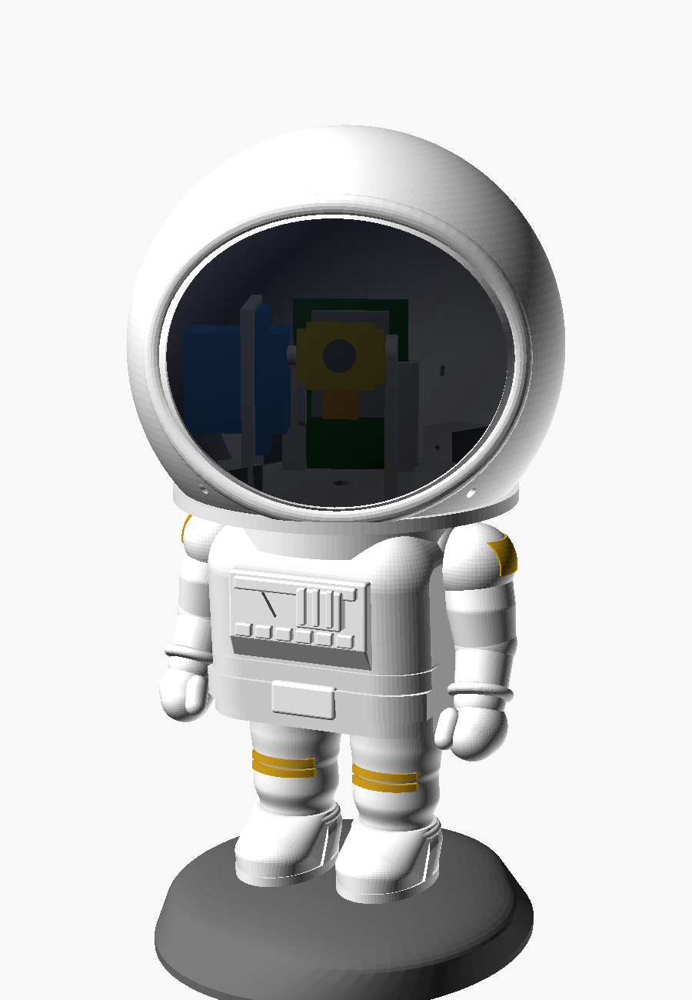
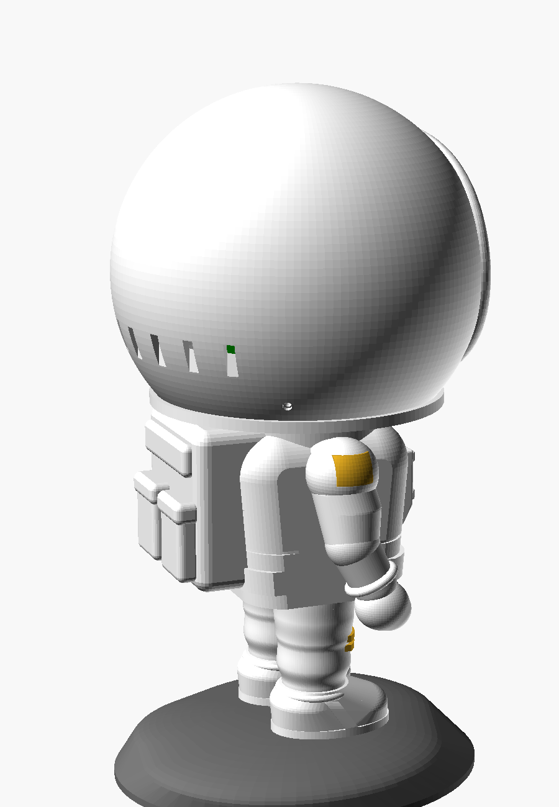
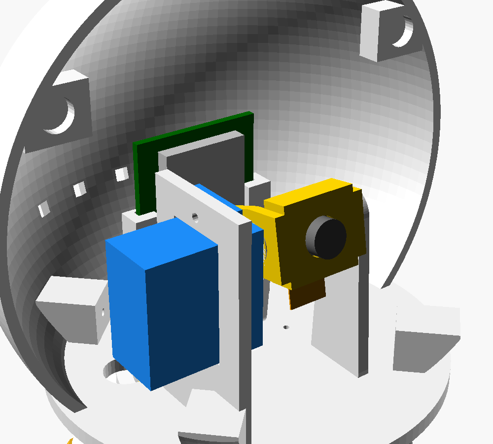

# 👨‍🚀 Astronaut Cam: אסטרונאוט מודפס עם מצלמת WiFi בקסדה

אסטרונאוט בסגנון "מקרן הגלקסיה" המוכר, בגובה של כ־19 ס"מ, להדפסה בתלת־ממד. בתוך הקסדה יש מצלמת WiFi (ESP32-CAM), ושולטים בה מהטלפון:
- **Pan:** כל הקסדה מסתובבת שמאלה וימינה (180°) בעזרת סרבו שנמצא בגוף.
- **Tilt:** המצלמה שבתוך הקסדה מטה את המבט למעלה ולמטה (בערך ±35°) מאחורי פתח הוויזור.
- **אפליקציה:** דף אינטרנט שה־ESP32 עצמו מגיש. יש בו וידאו חי, ג'ויסטיק, סליידרים, פנס, צילום, החלפת רזולוציה והיפוך תמונה. בטלפון אפשר לבחור "הוסף למסך הבית" והוא יעבוד כמו אפליקציה רגילה. לא צריך שרת ולא צריך ענן.

**העיצוב:** הפרופורציות לקוחות מצעצוע "מקרן הגלקסיה" (כ-23×12×11 ס"מ, קסדה של כ-10 ס"מ). הקסדה היא כמחצית מגובה הדמות, והגוף והרגליים קצרים וקומפקטיים.
- **קסדה:** כדור חלק לגמרי, עם ויזור כהה ומסגרת מעוגלת.
- **גוף:** מעוגל, עם פאנל שליטה על החזה (משולש, פסים ומקלדת) וחגורה עם אבזם.
- **ידיים ורגליים:** חלקות ומעט מכופפות, עם אגרופים עגולים ומגפיים עם רצועה.
- **פרטי זהב:** פסים בברכיים ופאץ' בכתפיים.
- **תיק גב:** עם שני כיסים.
- **בסיס:** סלע ירח עם מכתשים.

הרגליים נבנו בסיבוב של פרופיל רציף (lathe), והמשטחים בחלוקה גבוהה, כדי שלא יראו מדרגות או פאות.

| מבט מלפנים | מבט מהצד | פנים הקסדה (בלי החצי הקדמי) |
|---|---|---|
|  |  |  |

```
astronaut-cam/
├── cad/astronaut.scad              מודל פרמטרי (OpenSCAD) לכל החלקים
├── stl/*.stl                       קבצים מוכנים להדפסה, כבר בכיוון ההדפסה
├── firmware/AstronautCam/          קוד ל-ESP32-CAM (Arduino)
│   ├── AstronautCam.ino
│   └── index_html.h                אפליקציית השליטה (HTML/JS)
└── images/                         הדמיות
```

---

## 1. רשימת רכיבים (BOM)

| רכיב | כמות | הערות |
|---|---|---|
| ESP32-CAM (AI-Thinker) | 1 | עדיף עם מתכנת **ESP32-CAM-MB** (USB) |
| מודול מצלמה **OV2640 עם כבל flex ארוך של 75 מ"מ** | 1 | הכבל הקצר שמגיע עם הלוח לא יגיע. גרסה עם עדשה של 120° נותנת שדה ראייה רחב יותר |
| סרבו SG90 (או MG90S עם גלגלי שיניים ממתכת) | 2 | אחד ל-Pan ואחד ל-Tilt |
| ספק 5V 2A + מודול USB-C breakout | 1 | ESP32-CAM עם שני סרבואים צורך שיאי זרם |
| קבל אלקטרוליטי 470–1000µF / 10V | 1 | על קו ה-5V. מונע ריסטים (brownout) |
| כבל מאריך לסרבו, 3 גידים, כ-15 ס"מ | 1 | עובר בצוואר: 5V, GND ואות Pan |
| מתג החלקה קטן | 1 | אופציונלי, נכנס לתיק הגב |
| ברגים M2×8 (קודחים לעצמם) | ~10 | 4 לקסדה, 4 לסרבואים, 1 לציר המצלמה |
| מגנטים 6×2 מ"מ | 4 | סוגרים את שני חצאי הקסדה |
| פילמנט 1.75 מ"מ (שאריות) | 2 ס"מ | פינים לחיבור הידיים |
| יריעת PET שקופה כהה (smoked), כ-80×70 מ"מ | 1 | ויזור כהה כמו בצעצוע |

עלות משוערת: 60–90 ₪.

---

## 2. הדפסה

כל קובץ ב-`stl/` כבר מסובב לכיוון ההדפסה הנכון. הגדרות מומלצות: PLA או PETG, שכבה 0.2 מ"מ, 3 קירות, מילוי 15%.

| חלק | קובץ | כמות | תמיכות | צבע מומלץ |
|---|---|---|---|---|
| בסיס ירח | `moon_base.stl` | 1 | לא | אפור |
| רגליים + מגפיים (2 חלקים בקובץ) | `legs.stl` | 1 | לא | לבן (פסי הברך: צביעה בזהב) |
| גוף | `torso.stl` | 1 | לא (התקרה הפנימית בשיפוע של 45°) | לבן |
| דיסק סרבו (בתוך הצווארון) | `deck.stl` | 1 | לא | כל צבע |
| יד ימין / שמאל | `arm_right.stl`, `arm_left.stl` | 1+1 | כן, רק מהמשטח | לבן (פאץ' זהב בכתף: צביעה) |
| תיק גב (קופסת חשמל) | `backpack.stl` | 1 | לא (גשר קצר בתקרה) | לבן |
| פלטפורמת הקסדה | `platform.stl` | 1 | לא | לבן |
| קסדה, חצי קדמי | `helmet_front.stl` | 1 | לא | לבן |
| קסדה, חצי אחורי | `helmet_back.stl` | 1 | לא | לבן |
| מחזיק מצלמה | `cam_holder.stl` | 1 | לא | זהב/שחור |

> שני חצאי הקסדה מודפסים על משטח החיתוך. הכיפה גדלה כלפי מעלה, ולכן לא צריך תמיכות.
> **פרטי הזהב:** פסי הברך והפאץ' שבכתפיים בולטים מעט מהמשטח, ולכן קל לצבוע אותם בצבע אקרילי זהב ומכחול דק.
> **משטח חלק:** לגימור חלק במיוחד מדפיסים בשכבה של 0.12–0.16 מ"מ (או עם Variable Layer Height ב-PrusaSlicer/Cura), ומשייפים קלות. אפשר גם להשתמש ב-filler primer ולצבוע בספריי לבן מט.
> **ויזור כהה:** מדביקים מבפנים יריעה שקופה כהה (smoked), למשל PET כהה או מדבקת כהיית חלונות על PET שקוף. כך עובדות גם מצלמות כיפה: מבחוץ הוויזור נראה שחור והמצלמה רואה דרכו. בלי יריעה, הפתח נשאר פתוח והחלק הפנימי נראה.

### התאמת המודל
הכול פרמטרי ב-`cad/astronaut.scad`. לפני שמדפיסים כדאי למדוד את מודול המצלמה ולעדכן את הפרמטרים:
- `cam_sq`: רוחב הבסיס המרובע של העדשה (ברירת מחדל 8.6 מ"מ)
- `lens_d`: קוטר קנה העדשה (ברירת מחדל 7.4 מ"מ)

ייצוא של חלק בודד:
```bash
openscad -D 'part="helmet_front"' -o helmet_front.stl cad/astronaut.scad
```
הדמיה עם זוויות לבחירה: `-D 'part="assembly"' -D pan_angle=40 -D tilt_angle=-20`

---

## 3. חיווט

```
                  ┌──────────── בתוך הקסדה ───────────┐
 USB-C 5V ─┬─ 5V ─┼──► ESP32-CAM 5V                     │
 (תיק גב)  │      │    ESP32-CAM GND ◄─────────── GND ──┼─┐
           │      │    GPIO13 ───────► סרבו Tilt (כתום) │ │
           │      │    5V/GND ───────► סרבו Tilt (אדום/חום)
           │      │    GPIO14 ──┐                       │ │
           │      └─────────────┼───────────────────────┘ │
           │          כבל צוואר │ (3 גידים: 5V, GND, PAN)  │
           │                    ▼                         │
           ├──────────► סרבו Pan (בגוף): אדום=5V          │
 GND ──────┴──────────►          חום=GND ◄────────────────┘
                                 כתום=GPIO14
   קבל 470–1000µF בין 5V ל-GND, קרוב ל-ESP32-CAM
```

| פין ESP32-CAM | מתחבר אל |
|---|---|
| 5V | 5V מהספק |
| GND | GND משותף לכל הרכיבים |
| GPIO 14 | אות סרבו Pan |
| GPIO 13 | אות סרבו Tilt |
| GPIO 4 | נורת הפלאש שעל הלוח, משמשת כפנס בקסדה (לא צריך לחבר כלום) |

- כדאי להלחים את החוטים ישר ללוח, בלי פיני header. כך הלוח נכנס למסילות בקלות.
- כבל ה-flex הארוך של המצלמה מתחבר למחבר שעל הלוח. משאירים לולאה רפויה, כי המצלמה זזה.
- לא משתמשים בכרטיס ה-SD, ולכן GPIO 13 ו-14 פנויים.

---

## 4. הרכבה

1. **רגליים:** לוחצים את המגפיים על הפינים של `moon_base`, ואת הפינים שבראש הרגליים לחורים שבתחתית `torso`. מדביקים.
2. **ידיים:** חותכים 2 פינים מפילמנט 1.75 באורך 10 מ"מ, מכניסים לחורים שבמשטחים השטוחים בצד הכתפיים ומדביקים.
3. **סרבו Pan:** מכניסים את ה-SG90 מלמעלה דרך החור ב-`deck`, כך שהציר יוצא במרכז הדיסק, ומבריגים 2 ברגים. מעבירים את כבל הצוואר דרך החריץ המעוגל בדיסק ומכניסים את הדיסק לצווארון. הלשונית נכנסת לחריץ ומונעת סיבוב.
4. **מרכוז:** מחברים את ה-ESP32 (אחרי צריבה) ושולחים את הסרבואים למרכז בכפתור "מרכז". רק אחר כך מחברים את הזרועות (horns).
5. **פלטפורמה:** מניחים את הזרוע הצלבית של סרבו ה-Pan בשקע שבתחתית `platform`. אפשר להדביק או לחבר ב-2 ברגים קטנים. אז לוחצים אותה על ציר הסרבו כשהקסדה פונה קדימה ומבריגים את בורג הציר דרך החור המרכזי.
6. **סרבו Tilt:** מכניסים אותו למגדל שבפלטפורמה מצד שמאל, עם הציר פונה למרכז, ומבריגים 2 ברגים.
7. **מצלמה:** מדביקים את מודול ה-OV2640 בכיס שב-`cam_holder` (העדשה עוברת בחור הקדמי וכבל ה-flex יוצא למטה). מדביקים את הזרוע הבודדת של הסרבו בשקע שבצד המחזיק, לוחצים אותה על ציר סרבו ה-Tilt ומבריגים בורג M2 בציר הנגדי דרך העמוד הימני.
8. **ESP32-CAM:** מחליקים את הלוח מלמעלה למסילות האחוריות, עם צד המצלמה והמחבר פונה קדימה, ומחברים את כבל ה-flex.
9. **קסדה:** מדביקים את יריעת הוויזור הכהה מבפנים למסגרת. מדביקים מגנטים בשקעים שבתפר, בקוטביות הפוכה בכל חצי. סוגרים את שני החצאים סביב הפלטפורמה ומבריגים 4 ברגי M2 בבליטות שבתחתית.
10. **תיק גב:** מכניסים את ה-USB-C ומדביקים לגב. החוטים עוברים דרך החלון שבגב הגוף.

---

## 5. צריבת הקוד

1. ב-Arduino IDE מתקינים את חבילת הלוחות **esp32 by Espressif**. גרסה 2.x או 3.x, שתיהן נתמכות.
2. פותחים את `firmware/AstronautCam/AstronautCam.ino`.
3. מעדכנים את פרטי הרשת בראש הקובץ:
   ```cpp
   const char *WIFI_SSID = "YOUR_WIFI";
   const char *WIFI_PASS = "YOUR_PASSWORD";
   ```
   אם משאירים את הערכים כמו שהם, או שאין חיבור לרשת, האסטרונאוט פותח נקודה חמה בשם **Astronaut-Cam** עם הסיסמה `astronaut123`.
4. הגדרות לוח: **Board:** AI Thinker ESP32-CAM, **Partition:** Huge APP, **PSRAM:** Enabled.
5. צורבים דרך ה-ESP32-CAM-MB. עם מתאם FTDI צריך לחבר IO0 ל-GND בזמן הצריבה.
6. ב-Serial Monitor (115200) מופיעה הכתובת.

## 6. השימוש באפליקציה

- נכנסים ל-**http://astronaut.local** (או לכתובת ה-IP שהודפסה). במצב נקודה חמה הכתובת היא http://192.168.4.1
- **ג'ויסטיק:** ככל שמזיזים אותו יותר רחוק מהמרכז, הראש זז מהר יותר. ימינה מסובב את הראש ימינה, למעלה מרים את המבט.
- **סליידרים:** קובעים זווית מדויקת.
- **כפתורים:** שמאל, מרכז, ימין, 💡 פנס (הקסדה זוהרת מבפנים), 📸 צילום (שומר JPG), רזולוציה, היפוך ומראה.
- **מקלדת:** במחשב עובדים גם החיצים.
- **"אפליקציה":** בכרום או בספארי בוחרים "הוסף למסך הבית".

### API (לשילוב ב-Home Assistant, Node-RED וכו')
| כתובת | פעולה |
|---|---|
| `GET /move?pan=90&tilt=100` | זווית מוחלטת |
| `GET /move?dp=10&dt=-5` | תזוזה יחסית |
| `GET /move?center=1` | חזרה למרכז |
| `GET /flash?on=1` | פנס |
| `GET /cam?var=framesize&val=9` | הגדרות מצלמה (`framesize`, `quality`, `vflip`, `hmirror`, `brightness`) |
| `GET /status` | מצב בפורמט JSON |
| `GET /capture` | תמונת JPG |
| `GET :81/stream` | וידאו MJPEG |

---

## 7. כיול וטיפים

- **הראש מסתובב הפוך?** משנים ל-`PAN_INVERT = true` או `TILT_INVERT = true`.
- **התמונה הפוכה?** לוחצים "היפוך" ו/או "מראה" באפליקציה.
- **טווח ה-Tilt** מוגבל ל-55°–125° כדי שהמחזיק לא יפגע בקסדה ושהעדשה לא תסתתר מאחורי שפת הוויזור. משנים ב-`TILT_MIN` וב-`TILT_MAX`.
- **ריסטים או ניתוקים?** בכמעט כל המקרים הבעיה היא אספקת החשמל. משתמשים בספק 2A ובקבל, ובכבל USB קצר ועבה.
- **רעידות בסרבו:** הקוד מפסיק לשלוח פולסים אחרי 1.5 שניות בלי תזוזה, והסרבו נשאר במקומו מחיכוך. זה גם חוסך חשמל.
- **תנועה חלקה:** `SERVO_STEP_DEG` קובע את המהירות המקסימלית (מעלות לכל 20ms).
- **קליטת WiFi חלשה:** קיימים לוחות ESP32-CAM עם מחבר IPEX. מעבירים את הנגד לאנטנה חיצונית ומוציאים אנטנה קטנה דרך הגב. היא אפילו נראית כמו אנטנת חללית 📡.

## 8. שדרוגים אפשריים
- **סיבוב 360° רציף:** סרבו רציף + slip ring קטן בצוואר + חיישן הול לנקודת אפס.
- **מעקב פנים או תנועה:** עיבוד ב-ESP32-S3 או בשרת חיצוני, שמחזיר פקודות `/move`.
- **קול:** רמקול קטן עם MAX98357A, להשמעת "Houston, we have a problem".
