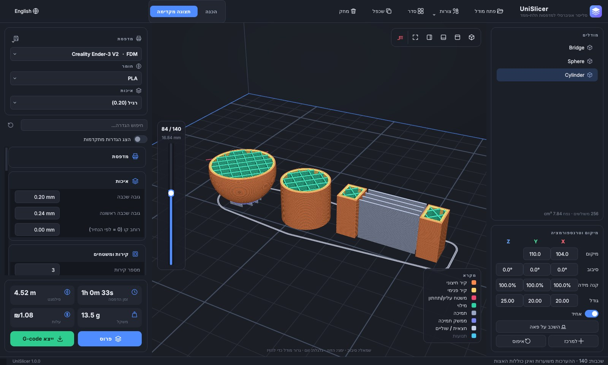
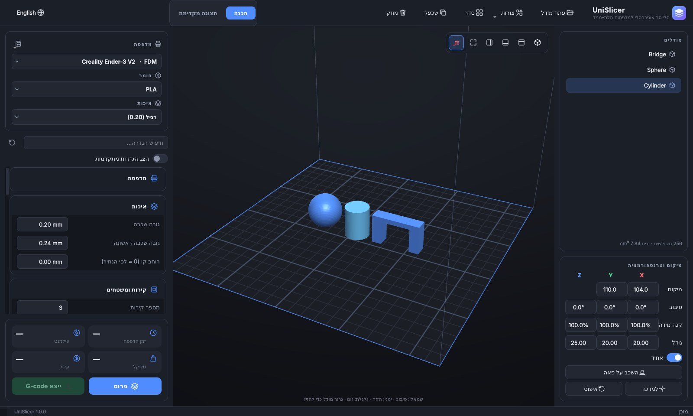
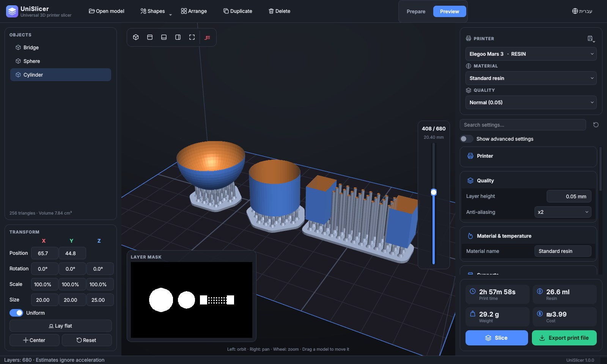

# UniSlicer — סלייסר אוניברסלי למדפסות תלת-ממד

UniSlicer הוא סלייסר בקוד פתוח למדפסות **FDM** (פילמנט) ולמדפסות **שרף** (SLA / MSLA).
הוא טוען מודלים, מסדר אותם על המשטח, פורס אותם לשכבות ומייצא קובץ שהמדפסת מדפיסה:
G-code למדפסות פילמנט, ותמונות שכבה (`.sl1` או ZIP של PNG) למדפסות שרף.
הממשק בעברית (מימין לשמאל) ובאנגלית, ויש גם שורת פקודה.



| הכנה (הדגשת אזורים תלויים) | שרף: תמיכות, רפסודה ומסכת שכבה |
|---|---|
|  |  |

## הורדה ל-Windows

- **קובץ התקנה:** [UniSlicer-Setup.exe](https://github.com/bennyzakala/Win11SysCheck/releases/download/unislicer-latest/UniSlicer-Setup.exe)
- **גרסה ניידת (בלי התקנה):** [UniSlicer-portable-win64.zip](https://github.com/bennyzakala/Win11SysCheck/releases/download/unislicer-latest/UniSlicer-portable-win64.zip). מחלצים ומריצים את `UniSlicer.exe`.

הקבצים נבנים אוטומטית ב-GitHub Actions (`.github/workflows/unislicer-windows.yml`) בכל עדכון של הקוד. הקובץ אינו חתום דיגיטלית, ולכן Windows עשוי להציג אזהרת SmartScreen. כדי להמשיך לוחצים על "מידע נוסף" ואז על "הפעל בכל זאת".

## הרצה מקוד המקור

נדרש Python 3.10 ומעלה וכרטיס מסך שתומך ב-OpenGL 3.3.

```bash
cd slicer
pip install -r requirements.txt
python run_unislicer.py
```

ב-Windows אפשר פשוט ללחוץ פעמיים על `run_unislicer.bat`: הוא מתקין את התלויות ומפעיל את התוכנה.

## מה יש בתוכנה

**כללי**
- טעינת קובצי STL (בינארי ו-ASCII), OBJ ו-3MF, גם בגרירה לחלון.
- בחירה ברורה של מודל (כתום עם מסגרת), וכלים לכיוון ידני: טבעות סיבוב סביב המודל (קפיצות של 1°, ועם Shift של 15°), לחיצה על פאה כדי להניח אותה על המשטח, וכפתורי "סובב 90°".
- המשטח מתאים את עצמו למדפסת שנבחרה: המודלים עוברים למרכז המשטח החדש והמצלמה ממוסגרת מחדש. אפשר גם לבחור גודל משטח (משטח מלא, או משטח שמוסיפים עם המידות שהיצרן מפרסם). במדפסות שרף המשטח הוא אזור ההדפסה על המסך.
- כמה מודלים על המשטח: סידור אוטומטי, שכפול ויצירת כמה עותקים, הזזה בגרירה, סיבוב, קנה מידה (אחיד או לפי ציר), שיקוף ו"השכבה על פאה".
- בחירה מרובה (Ctrl/Shift+לחיצה, גרירת מלבן עם Ctrl/Shift, Ctrl+A) ועריכה של כל המודלים הנבחרים יחד.
- לחיצה על מודל פותחת סרגל עריכה צף ליד המודל: אוריינטציה ידנית, כיוון אוטומטי, הנחת פאה, הזזה למיקום מדויק, שינוי גודל, שיקוף, הורדה למשטח, שכפול, תמיכות ומחיקה. לחיצה ימנית פותחת תפריט מלא.
- סידור אוטומטי (Auto layout): לפי קו המתאר או המלבן החוסם או ברשת, מרווח ושוליים, סיבוב סביב Z, כל החלקים או הנבחרים בלבד או רק מה שמחוץ למשטח, ריכוז במרכז או בפינה, סדר מיקום, ומילוי המשטח בעותקים. העוזר לומד את ההעדפות.
- ערכות מראה: כהה, בהיר ו-PRODENTIX עם קובץ לוגו לבחירה.
- ביטול וביצוע חוזר (Ctrl+Z / Ctrl+Y), שמירה ופתיחה של פרויקט (`.unislicer`), וייצוא STL של המודל יחד עם התמיכות.
- עבודה מהירה גם עם מודלים גדולים: הזזה וסיבוב בלי השהיות, וחיתוך לשכבות וייצוא שמנצלים את כל ליבות המעבד.
- סימון באדום של מודל שחורג מאזור ההדפסה, והדגשה של אזורים תלויים שיצטרכו תמיכה.
- 36 פרופילי מדפסות מובנים (Elegoo, ‏Anycubic, ‏Phrozen, ‏Prusa, ‏Creality, ‏Voron ועוד), מקובצים לפי יצרן.
- ספריית חומרים: 37 שרפים מוכנים מ-8 יצרנים (Elegoo, ‏Anycubic, ‏Siraya Tech, ‏Phrozen, ‏Sunlu, ‏Prusa, ‏Liqcreate ושרפים כלליים) ו-6 סוגי פילמנט.
- חלון ספרייה למדפסות ולחומרים: חיפוש לפי יצרן, עריכה של כל הגדרה, יצירה, שכפול ומחיקה, שחזור פרופיל מובנה, וייבוא וייצוא בקובצי JSON.
- הכנה אוטומטית בלחיצה אחת, בסגנון PreForm: כיוון אוטומטי של כל המודלים, סידור על המשטח ותמיכות. אפשר גם להפעיל כיוון אוטומטי למודל בודד.
- כ-80 הגדרות עם חיפוש. ליד כל הגדרה ששיניתם מופיע כפתור שמחזיר אותה לערך של הפרופיל.

**מדפסות פילמנט (FDM)**
- קירות, משטחים עליונים ותחתונים, ומילוי בחמש תבניות: רשת, קווים, משולשים, ג'ירואיד וקונצנטרי.
- תמיכות אוטומטיות שמתחילות מהמשטח או מכל מקום, עם שכבות ממשק צפופות ומרווח מהמודל.
- חצאית (skirt) או שוליים (brim).
- נסיגה (retraction), הרמת Z, נסיגת קושחה (G10/G11), ומעבר בתוך החלק בלי נסיגה כשאפשר.
- G-code ל-Marlin, ‏Klipper, ‏RepRapFirmware, ‏Prusa ו-Smoothieware, עם אקסטרוזיה יחסית או מוחלטת ומשטח שהראשית שלו במרכז (מדפסות דלתא).
- הערות `;TYPE:` / `;LAYER:` בסגנון Cura ו-`M73` להצגת התקדמות, כך ש-OctoPrint ומציגי G-code אחרים מזהים את הקובץ.
- תצוגה מקדימה תלת-ממדית של המסלולים לפי שכבה, בצבע לפי סוג. יש גם הערכה של זמן ההדפסה, אורך ומשקל הפילמנט והעלות.

**שפות תצוגה:** עברית, English, ‏Русский ו-العربية, עם כיוון מימין לשמאל לעברית ולערבית. בוחרים את השפה בכפתור השפה (הגלובוס) או בתוכנת ההתקנה, ובהפעלה הראשונה נבחרת שפת המערכת.

**חיבור ל-3Shape / exocad / Medit** (כמו החיבור של Phrozen DS Slicer ל-3Shape)
- תיקייה במעקב: כל קובץ חדש שתוכנת התכנון מייצאת אליה מיובא אוטומטית.
- סוג העבודה (מודל, גדם, כתר / גשר, סד, מדריך כירורגי, תותבת) מזוהה משם הקובץ ומקובץ ההזמנה של 3Shape. מקובץ ההזמנה נקרא רק סוג העבודה, בלי פרטי מטופל.
- לכל סוג מוחלים כיוון, תמיכות וסידור על המשטח.
- "פתח באמצעות UniSlicer" זמין לקבצי STL, ‏3MF, ‏OBJ ו-PLY. קבצים שנשלחים כש-UniSlicer כבר פתוח מתווספים למשטח הקיים.

**גוונים דנטליים (TrueDent / PolyJet)**
- גוון לכל שן, כתר או גשר בסולם VITA classical עם הקידומת T של GrabCAD Print (מ-TA1 עד TD4, כולל גווני הלבנה). לחניכיים יש 11 גוונים, מוורוד בהיר דרך גוונים אתניים ועד חום בהיר, ב-4 רמות שקיפות.
- "זהה שיניים וחניכיים" מזהה בתותבת שנשמרה כקובץ אחד את הבסיס ואת כל שן, וממספר את השיניים לאורך הקשת. התותבת נשארת מודל אחד, כך שהיא זזה, מסודרת ומודפסת בשלמותה, ולכל אזור יש גוון משלו.
- קובץ 3MF עם גוונים, כמו שהוא יוצא מ-3Shape, נטען עם הגוונים. הייצוא ל-GrabCAD Print כותב חומר לכל משולש עם שם הגוון וצבע התצוגה שלו, יחד עם רמת השקיפות בקצה החותך (TrueVoxel).

**שליחה למדפסות ברשת (Wi-Fi / כבל)**
- כפתור Wi-Fi ליד "ייצוא" שולח את הקובץ החתוך ישר למדפסת, ואפשר גם להתחיל להדפיס מיד.
- "חפש מדפסות ברשת" סורק את כל הרשת המקומית ומזהה כל מדפסת לפי השירות שהיא מפעילה. אם יש פרופיל מתאים, המדפסת מקושרת אליו.
- ELEGOO ולוחות ChiTu (פרוטוקול SDCP: Saturn 3/4 Ultra, Mars 5 Ultra): שליחת הקובץ, התחלת הדפסה ומצב ההדפסה.
- Creality במצב LAN (‏SPARKX i7, ‏K1, ‏K2, ‏Hi, ‏Ender-3 V3): שליחת הקובץ, התחלת הדפסה ומצב ההדפסה. אם במדפסת רץ Moonraker, התוכנה משתמשת בו.
- Prusa דרך PrusaLink (‏SL1/SL1S, ‏MK4, ‏XL), ‏OctoPrint, ו-Klipper/Moonraker (‏Mainsail, ‏Fluidd, ‏Creality K1, ‏Neptune 4).
- תיקייה ברשת, כונן משותף או USB: למדפסות שעובדות רק עם התוכנה או הענן של היצרן.
- "בדוק חיבור" מסביר מה לבדוק כשמשהו לא עובד (כתובת IP, מפתח API, אותה רשת, חומת אש). הרשימה נשמרת ב-`network_printers.json`.

**עוזר חכם שלומד מהשימוש**
- **כיוון אוטומטי:** כשמשנים כיוון שהכיוון האוטומטי בחר, העוזר מעדכן את המשקלים שלפיהם הכיוון האוטומטי מדרג אפשרויות, כך שהבחירות הבאות קרובות יותר להעדפה שלכם.
- **תמיכות:** תמיכות שמוסיפים או מוחקים אחרי יצירה אוטומטית משנות את הצפיפות ואת זווית הסף של התמיכות האוטומטיות בפעם הבאה.
- **משוב על הדפסה:** אחרי ייצוא מופיעה השאלה "איך יצאה ההדפסה?". דיווח על כשל (תמיכות, יניקה, הידבקות) מכוון את הלמידה ומציג תיקון מתאים בלחיצה אחת.
- **הצעות ברקע:** בעיות במודל (כוסות יניקה, איים, מודל לא אטום) ושיפורים אפשריים (כיוון טוב יותר, חלילה, תמיכות עץ, עוד עותקים על המשטח). העוזר מציע גם לשמור כברירת מחדל הגדרה שמשנים שוב ושוב, ומציג קיצורי מקלדת לפעולות שחוזרות.
- **סידור:** האפשרויות שבוחרים בסידור האוטומטי והתיקונים הידניים אחריו (מרווח, שוליים, מרכז או פינה) הופכים לברירת המחדל של הסידור הבא.
- **שחזור מודלים שלא נטענים:** כשקובץ לא נטען, הסוכן מנסה לשחזר אותו. הוא מטפל בכותרת STL שגויה או בקובץ שנקטע, בפסיק עשרוני, בסיומת שלא מתאימה לתוכן, בפאות שמצביעות על קודקודים חסרים, ב-3MF של Bambu, ‏Orca ו-PrusaSlicer שמחולק לכמה קבצים, בקבצים בתוך ZIP או GZIP, ובמודל שנשמר במטרים. כל משולש תקין נשמר בדיוק המקורי, בלי פישוט. רק משולשים פגומים מושמטים וחורים קטנים נסגרים, ופתח גדול כמו בסיס של סריקה נשאר כמו שהוא. הסוכן לומד איזה תיקון עובד לכל סוג קובץ ולכל תוכנה שייצאה אותו, ומנסה אותו ראשון בפעם הבאה. נוספה גם תמיכה ב-PLY וב-AMF.
- **אבחון תקלות:** כשמשהו נכשל התוכנה לא נסגרת. הסוכן מזהה את התקלה ומציג חלון: מה קרה, באיזה חלק בתוכנה ובאיזו פעולה, מה הסיבה (כרטיס מסך, זיכרון, דיסק מלא, קובץ נעול או חסר, מודל פגום, הגדרה עם ערך 0, פרופיל פגום או באג), ושלבי תיקון. תקלה שחוזרת מזוהה ומוצגת בחלונית הסוכן. אם התוכנה נסגרה בפתאומיות (למשל בדרייבר של כרטיס המסך), האבחון מוצג בהפעלה הבאה. הדוחות נשמרים ב-`crashes.jsonl` ואפשר להעתיק דוח בלחיצה.
- **פרטיות:** הכול נשמר רק במחשב שלכם, בקובץ `learning.json` בתיקייה `‎~/.unislicer`. אפשר לכבות את הלמידה או לאפס אותה.

**טכנולוגיות פוטופולימר:** LCD/MSLA, ‏DLP (כולל Asiga MAX 2, ‏PRO 4K ו-ULTRA), SLA בלייזר (Formlabs Form 3+/3L ומדפסות פתוחות) ו-PolyJet (‏Stratasys Objet30 Pro, ‏J5 DentaJet, ‏J850). לכל תהליך מוצגות ההגדרות שלו:
- SLA בלייזר: פיצוי קרן, קווי מתאר, מרווח וזווית סריקה וסיבוב שלה בכל שכבה; ייצוא CLI (קווי מתאר וסריקה) והערכת זמן לפי אורך הסריקה.
- DLP ו-Asiga: ייצוא SLC (קווי מתאר כולל תמיכות) לייבוא ב-Asiga Composer.
- PolyJet: תמיכת ג'ל לכל שכבה (מט או מבריק), הערכת חומר מודל וחומר תמיכה, חומר לכל חלק, וייצוא 3MF ל-GrabCAD Print.
- טווחי גובה (Multi-range בסגנון Asiga): עובי שכבה וחשיפה שונים לכל טווח.

**מדפסות שרף (SLA / MSLA)**, עם רוב היכולות של CHITUBOX:
- עריכת תמיכות אחרי יצירה: לחיצה על תמיכה מסירה אותה (התמיכה שמתחת לסמן מסומנת באדום), לחיצה על המודל מוסיפה תמיכה (מקש S).
- אפשרויות תמיכה נוספות: צפיפות, הטיית ראש לכיוון פני השטח, עמודים שמתעבים כלפי מטה, חיזוקים אלכסוניים בין עמודים, והדפסה ישירה על המשטח למודל מסוים.
- תמיכות עץ (מסתעפות) או עמודים ישרים. בתמיכות עץ הענפים מתאחדים לגזעים משותפים ומתרחקים מהמודל, כך שנדרש פחות שרף ויש פחות נקודות מגע עם הרפסודה.
- תמיכות: יצירה אוטומטית בשלוש רמות (קלות, בינוניות, כבדות), והוספה או הסרה של תמיכה בלחיצה על המודל. אפשר לקבוע עומק חדירה של הראש, תמיכות שנשענות על המודל, רפסודה ושוליים לרפסודה.
- חלילה (Hollowing) בעובי דופן לבחירה, עם חורי ניקוז אוטומטיים. התוכנה מציגה כמה שרף נחסך.
- עובי שכבה אדפטיבי לשרף: שכבות דקות במדרונות מתונים ועבות בקירות זקופים, עם פיצוי חשיפה לפי עובי (CTB/GOO/PRZ).
- בדיקת הדפסה אחרי הפריסה: איים, כוסות יניקה (חלל סגור שנוצר בו ואקום בכל הרמה) וחלקים דקים מ-0.3 מ"מ. כשאין בעיות מוצג סימן ✓ לכל בדיקה.
- פיצוי מידות לכל שרף, בסגנון Phrozen DS Slicer: התכווצות ב-XY וב-Z, פיצוי מידות XY ופיצוי "רגל פיל" בשכבות התחתונות.
- זיהוי איים, כלומר אזורים שמתחילים באוויר: הם מסומנים באדום בתמונת השכבה, ויש כפתור שקופץ לאי הבא.
- חשיפה ותנועה: שכבות תחתונות ושכבות מעבר, גובה ומהירות הרמה נפרדים לשכבות התחתונות, מהירות חזרה, זמני המתנה (לפני ההרמה, אחריה ואחרי החזרה), תנועה דו-שלבית (TSMC) ועוצמת אור (PWM).
- מסכות שכבה ברזולוציית המסך, עם החלקת קצוות עד x8, טשטוש תמונה ושיקוף.
- ייצוא ל-`.goo` (מדפסות Elegoo חדשות, כמו Saturn 3 Ultra ו-Mars 4 Ultra), ל-`.prz` (Phrozen Sonic Mini 8K S), ל-`.ctb` (פורמט CHITUBOX גרסה 4, למדפסות כמו Elegoo ו-Phrozen), ל-`.sl1` (Prusa ו-UVtools) או ל-ZIP של PNG עם קובץ `metadata.json`.
- הערכה של נפח השרף, המשקל, זמן ההדפסה והעלות.

## שליטה מרחוק (Google)

צפייה ושליטה במדפסות הרשת מכל מקום, מהטלפון או מכל דפדפן, עם חשבון Google. הקישור עובר דרך פרויקט Firebase של המעבדה, ולא צריך לפתוח פורטים בראוטר.

- **במחשב שליד המדפסות:** עוד › שליטה מרחוק › הפעל. UniSlicer מציג קוד בן 8 תווים, וצריך להישאר פתוח.
- **בטלפון:** נכנסים לדף השליטה (`remote_web/`), מתחברים עם Google ומקלידים את הקוד. במחשב מופיעה שאלה אם לאשר את החשבון, ורק אחרי "אשר" החשבון מקושר.
- **בדף השליטה:** מצב כל מדפסת (מדפיסה, מושהית, אחוז, שכבה, שם הקובץ), וכפתורים להשהיה, המשך ועצירה. עצירה דורשת אישור.
- **מדפסות נתמכות:** Creality (מצב LAN או Moonraker), ELEGOO (SDCP), Klipper/Moonraker, OctoPrint ו-PrusaLink.
- **אבטחה:**
  - חוקי האבטחה ב-`remote_web/database.rules.json` מאפשרים רק לבעלים לראות ולשלוח פקודות, ורק פקודות מוכרות.
  - פקודה ישנה מ-5 דקות לא מבוצעת.
  - סיסמאות ומפתחות API של המדפסות לא יוצאים מהמחשב.
  - אפשר לנתק את המחשב מהחשבון בתוכנה או בדף.

**הקמת פרויקט Firebase (פעם אחת):**
1. ב-[Firebase console](https://console.firebase.google.com/) יוצרים פרויקט.
2. ב-Authentication › Sign-in method מפעילים את Google ואת Anonymous.
3. יוצרים Realtime Database ומדביקים בלשונית Rules את התוכן של `database.rules.json`.
4. ב-Project settings › Your apps יוצרים Web app ומעתיקים את `firebaseConfig`: אל `remote_web/config.js`, ואל חלון השליטה מרחוק ב-UniSlicer.
5. מפרסמים את התיקייה `remote_web` ב-Firebase Hosting (`firebase deploy`) או ב-Netlify. כשמפרסמים ב-Netlify, מוסיפים את הכתובת שלו ל-Authentication › Settings › Authorized domains.

## שורת פקודה

```bash
python -m unislicer slice model.stl -p prusa_mk4 -m petg -q fine -s infill_pattern=gyroid -s support_enable=true
python -m unislicer slice model.stl -p elegoo_mars3 -s support_enable=true -o model.sl1
python -m unislicer list-profiles      # כל פרופילי המדפסות, החומרים והאיכות
python -m unislicer list-settings      # כל שמות ההגדרות לשימוש עם -s
```

## הגבלות ידועות (גרסה 1.0)

- **לא נבדק עדיין על מדפסת אמיתית.** קובצי ה-G-code נבדקו בבדיקות אוטומטיות: הקואורדינטות בתוך גבולות המשטח, כמות הפילמנט מתאימה לנפח המודל (בטווח של 5%), וכל סוגי הקושחה נבדקו. עדיין מומלץ לצפות בהדפסה הראשונה, ולבדוק את קוד ההתחלה (Start G-code) של המדפסת שלכם.
- מדפסות Bambu Lab דורשות קובץ `.gcode.3mf` חתום, ולכן אינן נתמכות.
- **קובצי ה-`.goo` וה-`.ctb` עדיין לא נבדקו על מדפסת.** קובץ ה-`.goo` נכתב לפי מפרט הפורמט ש-Elegoo פרסמה, ומשחזר בדיוק את דוגמאות הקידוד שבמפרט. קובץ ה-`.ctb` נכתב לפי הקוד הפתוח של UVtools, ונבדק כך שהקובץ נקרא בחזרה ומתקבלות בדיוק אותן תמונות שכבה. עדיין לא בדקתי אותו מול מדפסת או מול תוכנה חיצונית. מומלץ לפתוח אותו קודם ב-[UVtools](https://github.com/sn4k3/UVtools) או בתצוגה של המדפסת.
- הפורמט `.pwmx` (Anycubic) עדיין לא נתמך. אפשר להמיר אליהם את קובץ ה-`.sl1` בעזרת UVtools. לפני שמדפיסים, כדאי לוודא שהרזולוציה וגודל המסך בפרופיל תואמים לדגם שלכם.
- עדיין לא קיימים: מילוי פנימי (lattice) לחלל, חורי ניקוז במיקום ידני, גובה שכבה משתנה, ריבוי חומרים, זיהוי גשרים, ironing ומילוי פערים צרים (gap fill).
- ערכי החשיפה בספריית השרפים הם נקודת התחלה לפי סוג השרף, ולא ערכים שהיצרנים אישרו. זמני החשיפה תלויים במדפסת ובמסך שלה, ולכן כדאי להשוות לגיליון של יצרן השרף ולהדפיס מבחן כיול. גם המידות והרזולוציה של חלק מפרופילי המדפסות נכתבו מהזיכרון. אפשר לתקן אותם בחלון הספרייה.
- הערכת הזמן אינה מתחשבת בהאצות, ולכן ההדפסה בפועל בדרך כלל ארוכה יותר.

## מבנה הקוד

| קובץ | תפקיד |
|---|---|
| `unislicer/mesh.py` | טעינת STL/OBJ/3MF, ריתוך קודקודים, טרנספורמציות |
| `unislicer/slicing.py` | חיתוך הרשת לפוליגונים בכל שכבה |
| `unislicer/fdm.py`, `infill.py` | קירות, משטחים, מילוי, תמיכות, סדר המסלולים |
| `unislicer/gcode.py` | כתיבת G-code לכל סוג קושחה, והערכת זמן וחומר |
| `unislicer/sla.py`, `sla_supports.py` | תמיכות שרף, חלילה, איים, חשיפה, מסכות שכבה, ייצוא |
| `unislicer/ctb.py`, `goo.py` | כתיבה וקריאה של קובצי `.ctb` (CHITUBOX) ו-`.goo` (Elegoo) |
| `unislicer/parallel.py` | חלוקת העבודה בין ליבות המעבד |
| `unislicer/project.py` | קובצי פרויקט `.unislicer` |
| `unislicer/orient.py` | כיוון אוטומטי |
| `unislicer/assistant.py`, `gui/assistant_panel.py` | העוזר הלומד |
| `unislicer/gui/profile_manager.py` | חלון ספריית המדפסות והחומרים |
| `unislicer/settings.py` | טבלת ההגדרות שממנה נבנים הממשק, שורת הפקודה והפרופילים |
| `unislicer/network.py`, `remote.py`, `remote_web/` | מדפסות ברשת, ושליטה מרחוק דרך Firebase |
| `unislicer/profiles/*.json` | פרופילי מדפסות, חומרים ואיכות |
| `unislicer/gui/` | ממשק PySide6 ותצוגת OpenGL |

הרצת הבדיקות: `pip install pytest && python -m pytest`

---

## English

UniSlicer is an open-source slicer for **FDM** (filament) and **resin** (SLA/MSLA) printers, with a Hebrew/English GUI and a CLI.
It loads STL/OBJ/3MF files and outputs G-code (Marlin, Klipper, RepRapFirmware, Prusa, Smoothieware) or resin layer images (`.sl1` / PNG zip).
Features: five infill patterns, automatic FDM supports with interface layers, skirt and brim, retraction with z-hop, automatic resin supports with a raft,
a shaded 3D toolpath preview, and 17 built-in printer profiles plus profiles you save yourself.

```bash
cd slicer && pip install -r requirements.txt && python run_unislicer.py
```

**Remote control (Google sign-in):** More › Remote control links this computer to a Google account through the
lab's own Firebase project (no router ports). The owner opens the control page (`remote_web/`) on a phone, signs in
with Google, types the 8-character code, and confirms on the computer. The page then shows each network printer's
state and progress and can pause, resume or stop prints. Setup steps are in the Hebrew section above and in the
window itself.

The limitations above apply. In particular, the output has been tested automatically but not yet printed on real hardware, so watch your first print.
